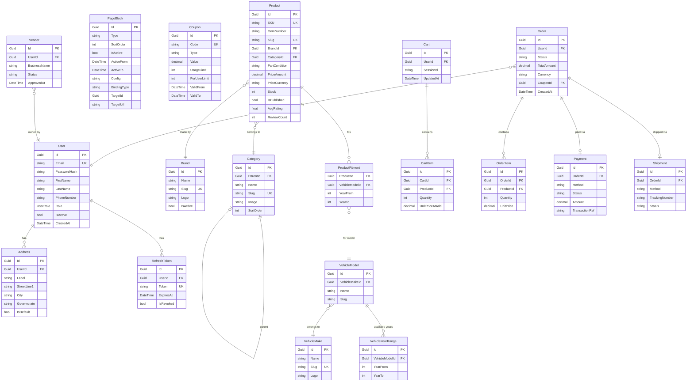

# Architecture

## Module Structure

```
PartZone.sln
├── src/
│   ├── PartZone.Host/                  Entry point, DI composition, AppDbContext, migrations
│   ├── PartZone.Shared.Kernel/         Result<T>, Error, ICommand/IQuery, Entity, AggregateRoot
│   └── Modules/
│       ├── Identity/                   Users, Addresses, RefreshTokens, Complaints
│       ├── Catalog/                    Brand, Category, Product, VehicleFitment
│       ├── Orders/                     Order, OrderItem, Payment, Shipment
│       ├── Marketing/                  PageBlock, BrandPageBlock, ListPageBlock, Coupon
│       ├── StoreSettings/              PaymentMethod, ShipmentMethod
│       ├── Vendors/                    Vendor accounts + product approval
│       ├── Cart/                       Server-side cart, guest merge
│       ├── Checkout/                   Cart→Order lifecycle, idempotency
│       └── Erp/                        IErpConnector, Odoo/Oracle/SAIB stubs, sync log
```

Each module is a 4-project vertical slice: `Domain → Application → Infrastructure → Api`.
Modules communicate only through public Application interfaces — never through each other's internals.

## Data Model (ERD)



## API Layer Split

| API | Endpoint | Consumer | Why |
|---|---|---|---|
| GraphQL (HotChocolate) | `/graphql` | Admin dashboard (Apollo Client) | Rich queries, cache, type generation |
| REST (Minimal APIs) | `/api/v1/` | Storefront Server Actions | Simple fetch, no client bundle overhead |

Both layers are thin wrappers over the same MediatR handlers in the Application layer.
